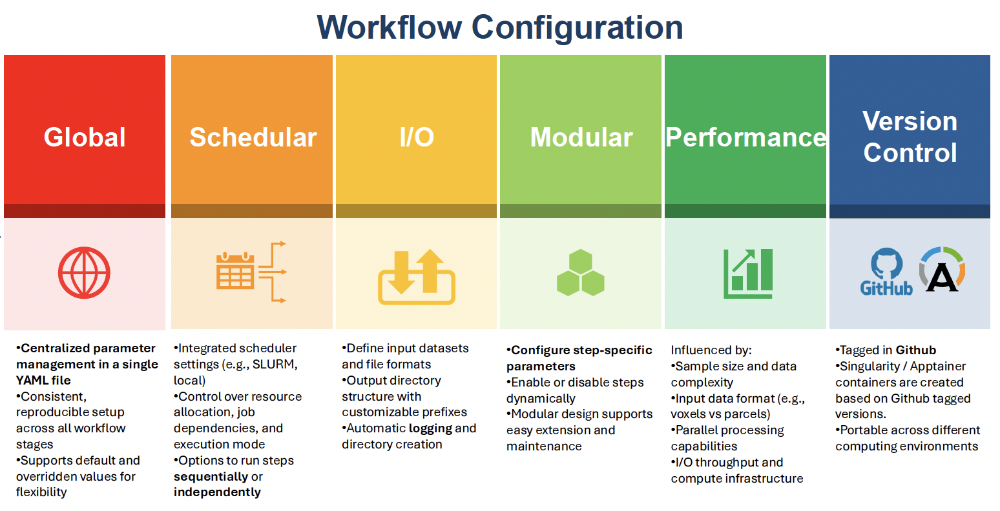

# BrainCAP

BrainCAP is a Python toolkit for studying moment-to-moment changes in
co-activation patterns (CAPs) in functional magnetic resonance imaging (fMRI)
data. It supports cross-sectional and longitudinal analyses by selecting
frames, clustering spatial brain-state observations, evaluating candidate
cluster solutions, and calculating subject-level temporal CAP measures.

The repository is under active development. The current implementation is
research software rather than a versioned production release and is primarily
configured for Linux/HPC workflows. Validate all preprocessing and analysis
choices against the needs of your study before interpreting results.



## What BrainCAP does

The main workflow is:

1. **Concatenate runs** (optional): combine multiple BOLD runs and, when
   required, their motion files within each session.
2. **Prepare data**: load session data, optionally apply global signal
   regression (GSR), select frames using motion and/or seed criteria, and
   create split-half datasets.
3. **Cluster frames**: apply a scikit-learn clustering method to the selected
   frame-by-feature matrix for each permutation and split.
4. **Post-process**: compare candidate cluster counts using silhouette scores,
   select a final solution, reorder CAPs consistently, and write basis CAPs and
   clustering results.
5. **Compute temporal metrics** (optional): calculate subject-level metrics from
   the final CAP labels.
6. **Run downstream modules** (optional): feature reduction and group comparison
   modules consume temporal-metric outputs. These modules are currently
   scaffolds and should be inspected and validated before use.

The pipeline uses split-half resampling. A permutation creates two subject
splits (`split1` and `split2`) and processes both independently. The number of
permutations is controlled by `global.permutations`.

## Repository layout

```text
BrainCAP/
├── README.md
├── environment_linux.yml
├── cap_linear_regression.R
├── brainCAP/
│   ├── braincap.py                    # YAML-driven workflow orchestrator
│   ├── braincap_concatenate.py        # Optional run concatenation
│   ├── braincap_prep.py               # Frame selection and preparation
│   ├── braincap_clustering.py         # Clustering
│   ├── braincap_post.py               # Cluster evaluation and CAP outputs
│   ├── braincap_temporal_metrics.py   # Subject-level temporal measures
│   ├── braincap_feature_reduction.py  # Downstream analysis scaffold
│   ├── braincap_group_comparison.py   # Downstream analysis scaffold
│   ├── braincap_functions/             # Shared loading, splitting, and utilities
│   ├── examples/                       # Configurations and session lists
│   └── images/                         # Workflow figures and presentation material
└── tutorials/OHBM2025/                # Demonstration script and configuration
```

Run commands from `BrainCAP/brainCAP`, or provide absolute paths to the
scripts.

## Installation

The supplied environment is Linux-oriented and currently pins Python 3.13 and
the scientific Python stack used by the pipeline.

```bash
conda env create -f environment_linux.yml
conda activate brainCAP
```

For a pip-based installation, use Python 3.13 and the checked-in
[`requirements.txt`](./requirements.txt):

```bash
python -m venv .venv
source .venv/bin/activate
python -m pip install --upgrade pip
python -m pip install -r requirements.txt
```

On Windows, activate the virtual environment with
`.venv\Scripts\activate` instead. The Conda environment is recommended for
Linux/HPC deployments because it also provides compiled libraries and system
runtime dependencies used by scientific Python packages.

For a local checkout, the orchestrator can be invoked directly:

```bash
python braincap.py --config=/path/to/config.yml --steps=prep --dryrun=yes
```

The current scheduler integration supports:

- `NONE`: run commands directly in the current environment.
- `SLURM`: submit jobs to Slurm using the scheduler fields in the YAML file.

All requested steps in one orchestration call must use the same scheduler
type. The repository has been developed and tested primarily in HPC
environments; adapt scheduler settings and paths for another cluster.

All path arguments accept the separator style native to the operating system.
Per-session input paths remain relative to `sessions_folder`; absolute Windows
paths such as `C:\data\sessions` and POSIX paths such as `/data/sessions` are
supported for global and output directories. Relative per-session paths also
accept either `/` or `\` and are normalized for the host operating system.
Paths used by `concatenate_bolds` may include `{session_id}`; BrainCAP expands
that placeholder from the session-list row before opening each session’s file.

## Input data contract

### Session directory

`global.sessions_folder` is the parent directory containing one directory per
session. The value in the `session_id` column identifies the child directory:

```text
sessions_folder/
├── 136833/
│   ├── bold_run1.ptseries.nii
│   └── motion.bstats
└── 922854/
    ├── bold_run1.ptseries.nii
    └── motion.bstats
```

`prep.bold_path`, `prep.motion_path`, and the paths in
`concatenate_bolds.bold_files`/`motion_files` are **relative paths inside each
session directory**. Do not use absolute paths for these per-session fields.

BrainCAP supports CIFTI and NIFTI BOLD data. Set `global.bold_type` to
`CIFTI` or `NIFTI`, or allow the implementation to infer the type from the
file extension where supported.

### Session list

`global.sessions_list` must be a CSV file with a `session_id` column. A
`group` column is optional for preprocessing but is required for analyses that
compare groups. Column names are case-sensitive in the current implementation.

```csv
session_id,group
136833,control
922854,control
131823,patient
```

Keep the session list stable for all steps in an analysis. Subject and group
labels are internally converted to indices in HDF5 outputs and mapped back
using this file.

## Configuration

The recommended interface is a YAML configuration passed to `braincap.py`.
Start with [`brainCAP/examples/config_params.yml`](./brainCAP/examples/config_params.yml)
as a parameter reference and copy
[`brainCAP/examples/example_config.yml`](./brainCAP/examples/example_config.yml)
as a starting point.

### Global settings

```yaml
global:
  sessions_folder: /data/sessions
  analysis_folder: /data/braincap_output
  sessions_list: /data/sessions.csv
  logs_folder: /data/braincap_output/logs
  permutations: 10
  tag: pilot
  bold_type: CIFTI
  scheduler:
    type: NONE
  cluster_args:
    _method: KMeans
    _variable: n_clusters
    n_clusters: [2, 3, 4, 5, 6]
    n_init: 10
    max_iter: 1000
```

Important fields:

| Field | Description |
|---|---|
| `sessions_folder` | Parent directory of session directories. |
| `analysis_folder` | Root directory for generated analysis data. |
| `sessions_list` | CSV containing `session_id`, and optionally `group`. |
| `logs_folder` | Directory for orchestration and step logs. |
| `permutations` | Number of split-half permutations. |
| `tag` | Optional prefix used to separate multiple analyses in one output folder. |
| `bold_type` | `CIFTI` or `NIFTI`. |
| `scheduler.type` | `NONE` or `SLURM`. |
| `cluster_args` | scikit-learn clustering method, variable to sweep, and method arguments. |

`cluster_args._method` must match a clustering method available to the
repository’s scikit-learn installation. `_variable` identifies the one
parameter whose list of values is evaluated in parallel, commonly
`n_clusters`. Only one clustering parameter should be a list.

### `concatenate_bolds`

This optional step combines runs in the order listed:

```yaml
concatenate_bolds:
  bold_files:
    - images/functional/bold1.ptseries.nii
    - images/functional/bold2.ptseries.nii
  bold_out: images/functional/bold12_concatenated.ptseries.nii
  motion_files:
    - images/functional/movement/bold1.bstats
    - images/functional/movement/bold2.bstats
  motion_out: images/functional/movement/bold12_concatenated.bstats
  ndummy: 100
  bold_labels: [1, 2]
  overwrite: no
```

`bold_files` and `bold_labels` must have the same length when labels are
provided. `motion_files` and `motion_out` are needed when the prepared
analysis will use motion scrubbing. The step writes the concatenated image,
an `*_info.csv` file containing session, group, and run labels, and optionally
a concatenated motion file.

### `prep`

```yaml
prep:
  bold_path: images/functional/bold12_concatenated.ptseries.nii
  gsr: yes
  scrubbing: yes
  motion_path: images/functional/movement/bold12_concatenated.bstats
  motion_type: fd
  motion_threshold: 0.5
  display_motion: no
  time_threshold: 100
  overwrite: yes
```

`bold_path` is required. If `scrubbing` is enabled, provide
`motion_path`, `motion_type`, and `motion_threshold`. `gsr` controls global
signal regression. `display_motion` requests motion plots.

Seed-based frame selection can be supplied under `global` or `prep`:

```yaml
seed_args:
  seed_based: yes
  seed: 1
  threshold_type: P
  threshold: 50
  event_type: activation
```

The seed may be a parcel index, a list of indices, or a matching mask file,
depending on the selected data representation. `threshold_type` is currently
intended to be `T` or `P`; `event_type` is `activation` or `deactivation`.

### `clustering`

The clustering step uses the selected frames written by preparation:

```yaml
clustering:
  overwrite: yes
```

The method and parameter sweep normally come from `global.cluster_args`.
Each candidate produces labels and silhouette-related outputs for each
permutation and split.

### `post`

```yaml
post:
  overwrite: yes
  save_image: no
  save_stats: yes
  cluster_selection: automatic
  use_all: yes
  parc_file: /data/parcellations/template.pscalar.nii
```

`cluster_selection: automatic` uses the mode of the selected cluster count
across permutations and checks that the two splits agree. A numeric value,
such as `cluster_selection: 4`, forces a specific solution. Set `save_image:
yes` and provide `parc_file` when CAP images should be reconstructed for a
parcellated analysis. `save_stats` writes cluster-count distribution figures.

## Running the workflow

### Dry run

Use a dry run to inspect generated commands and scheduler behavior before
launching jobs:

```bash
python braincap.py \
  --config=/data/config.yml \
  --steps=prep \
  --dryrun=yes
```

### Run individual steps

```bash
python braincap.py --config=/data/config.yml --steps=concatenate_bolds
python braincap.py --config=/data/config.yml --steps=prep
python braincap.py --config=/data/config.yml --steps=clustering
python braincap.py --config=/data/config.yml --steps=post
```

Run several compatible steps in sequence:

```bash
python braincap.py \
  --config=/data/config.yml \
  --steps=concatenate_bolds,prep,clustering,post
```

The configuration values are merged with command-line arguments; command-line
arguments take precedence. The canonical demonstration is
[`tutorials/OHBM2025/braincap_demo.sh`](./tutorials/OHBM2025/braincap_demo.sh),
with settings in
[`tutorials/OHBM2025/braincap_demo.yaml`](./tutorials/OHBM2025/braincap_demo.yaml).

### Running the repository test configuration

The [`testing/`](./testing/) folder contains a Windows-oriented test
configuration and session list. Its YAML file expects the test BOLD data under
the configured `sessions_folder`; update that path if the data is stored
elsewhere. The example uses `{session_id}` in the input BOLD filename so the
same configuration can process `ses-func01`, `ses-func02`, and other sessions
whose filenames differ by session. Run the complete pipeline from the
repository root with:

```powershell
python testing\run_testing.py
```

Inspect the generated commands without launching analysis jobs:

```powershell
python testing\run_testing.py --dry-run
```

Run selected steps:

```powershell
python testing\run_testing.py --steps=prep
python testing\run_testing.py --steps=clustering,post
```

Use a different configuration or script location when needed:

```powershell
python testing\run_testing.py `
  --config=C:\path\to\config.yml `
  --braincap-dir=C:\path\to\BrainCAP\brainCAP
```

## Output layout

For an analysis with `permutations: 2`, the output generally contains:

```text
analysis_folder/
├── logs/
├── perm1/
│   ├── data/
│   │   ├── sessions.hdf5
│   │   └── <tag>split1.hdf5
│   ├── KMeans_runs_split1/
│   ├── KMeans_runs_split2/
│   └── <tag>clustering_results_split*.hdf5
├── perm2/
├── figures/
│   ├── n_clusters_scree_perm*_*.png
│   └── n_clusters_distribution_split*.png
└── basis_CAPs/
    ├── <tag>basis_CAP_split*.hdf5
    └── <tag>reordered_clustering_results_perm*_split*.hdf5
```

The exact filenames include the selected clustering method, swept variable,
permutation, split, and optional tag. Important HDF5 datasets include:

- `cluster_means`: spatial mean for each CAP.
- `cluster_labels`: CAP assignment for each selected frame.
- `sublabel_all`: subject/session index for each frame.
- `grouplabel`: group index for each frame.
- `basis_CAP`: final basis CAP data.

Logs are written to the configured log directory (or to the step default when
running scripts directly). Inspect logs and the generated figures before
using a solution in downstream analyses.

## Temporal metrics

After post-processing, calculate subject-level CAP metrics:

```bash
python braincap_temporal_metrics.py \
  --analysis_folder=/data/braincap_output \
  --tag=pilot \
  --sessions_list=/data/sessions.csv \
  --permutations=10 \
  --metrics="FA|mDT|vDT"
```

The current command-line interface supports the following metric names:

| Code | Meaning |
|---|---|
| `FA` | Fractional occupancy / fraction of frames assigned to a CAP. |
| `mDT` | Mean dwell time. |
| `vDT` | Dwell-time variability. |
| `FO`, `DT`, `TP`, `CON`, `Ent` | Not implemented by the current script. |

The step writes `temporal_metrics/temporal_metrics.hdf5` and
`temporal_metrics/temporal_metrics_avg.hdf5` (with the optional tag prefix).
The script validates the requested metrics and computes `FA`, `mDT`, and `vDT`
columns. Metrics are based on the reordered CAP labels produced by
post-processing.

## Inspecting HDF5 outputs

Use [`read_hdf5.py`](./read_hdf5.py) to list and preview every HDF5 dataset
under an analysis output directory:

```powershell
python read_hdf5.py `
  "D:\path\to\braincap_output"
```

Inspect one file instead:

```powershell
python read_hdf5.py `
  "D:\path\to\braincap_output\basis_CAPs\basis_CAP_split1.hdf5"
```

Preview one dataset and limit the number of displayed values:

```powershell
python read_hdf5.py `
  "D:\path\to\braincap_output" `
  --dataset=cluster_means `
  --max-items=5
```

Export all datasets as NumPy `.npy` files:

```powershell
python read_hdf5.py `
  "D:\path\to\braincap_output" `
  --export-dir="D:\path\to\numpy_output"
```

Combine `--dataset` with `--export-dir` to export only one dataset. Exported
filenames include both the source HDF5 filename and dataset path, preventing
name collisions when an output directory contains multiple BrainCAP files.

The reader opens files read-only and reports each dataset’s path, shape, dtype,
and a compact value preview. It accepts both Windows and POSIX path formats.

## Downstream modules

The following commands consume the temporal-metric HDF5 outputs:

```bash
python braincap_feature_reduction.py \
  --analysis_folder=/data/braincap_output \
  --tag=pilot \
  --sessions_list=/data/sessions.csv

python braincap_group_comparison.py \
  --analysis_folder=/data/braincap_output \
  --tag=pilot \
  --sessions_list=/data/sessions.csv
```

These modules create `feature_reduction/` and `group_comparison/` output
directories, respectively. Their current source contains explicit
placeholders for additional analysis logic, so treat the generated HDF5 files
as scaffolding until the intended statistical procedures have been completed
and independently validated.

## Reproducibility checklist

Before sharing or publishing an analysis:

1. Record the repository revision and environment file used.
2. Preserve the exact YAML configuration and session-list CSV.
3. Record BOLD file provenance, parcellation, preprocessing, GSR, scrubbing,
   motion type, and motion threshold.
4. Record the number of permutations and the split-half procedure.
5. Record the clustering method, every candidate parameter value, and the
   selected cluster count.
6. Preserve logs, scree plots, cluster-count distributions, and final HDF5
   outputs.
7. Check that the selected cluster count is consistent across split halves,
   or document and justify a manual selection.

## Troubleshooting

### Files are not found

Check that `sessions_folder` contains directories named exactly like
`session_id` values and that every per-session path is relative. Verify the
CSV header is exactly `session_id`.

### Scrubbing fails

Set `scrubbing: yes` only when `motion_path`, `motion_type`, and
`motion_threshold` are supplied. Ensure the motion file corresponds to the
same run order and dummy-frame removal used for the BOLD data.

### A cluster count cannot be selected automatically

Automatic selection expects the two split halves to agree on the optimal
cluster count. Inspect the scree plots and either adjust the candidate range
or specify a justified numeric `cluster_selection`.

### Existing outputs are reused

Set `overwrite: yes` for the relevant step. Prefer a new `analysis_folder` or
`tag` when testing a changed preprocessing or clustering specification.

### Scheduler jobs do not start

Run the same configuration with `scheduler.type: NONE` or use `--dryrun=yes`
to inspect the generated command. For Slurm, verify the partition, memory,
CPU, wall time, account, and email settings for your cluster.

## Citation

If you use BrainCAP, cite:

> Kangjoo Lee, Jie Lisa Ji, Clara Fonteneau, Lucie Berkovitch, Masih Rahmati,
> Lining Pan, Grega Repovš, John H. Krystal, John D. Murray, and Alan
> Anticevic. “Human brain state dynamics are highly reproducible and
> associated with neural and behavioral features.” *PLOS Biology* 22(9):
> e3002808 (2024).

The code used for that publication is archived on
[Zenodo](https://zenodo.org/records/13251563). The current repository is an
ongoing development branch and should not be assumed to reproduce the archived
release without matching its code and environment.

## Project status and support

The official standalone release has not yet been announced. The current
`main` branch is optimized for the Yale HPC/Slurm environment, while the
project’s broader goal is a portable open-source toolkit supporting additional
job schedulers.

For questions and collaboration, contact the maintainers listed by the
project:

- Kangjoo Lee, PhD — [Computational Neuroimaging of Brain Disorders
  Laboratory](https://cnbdlab.github.io/)
- [Florida International University faculty profile](https://cec.fiu.edu/about/directory/profiles/kangjoo-lee.html)
